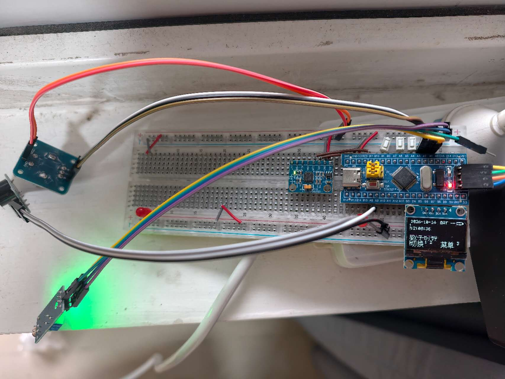
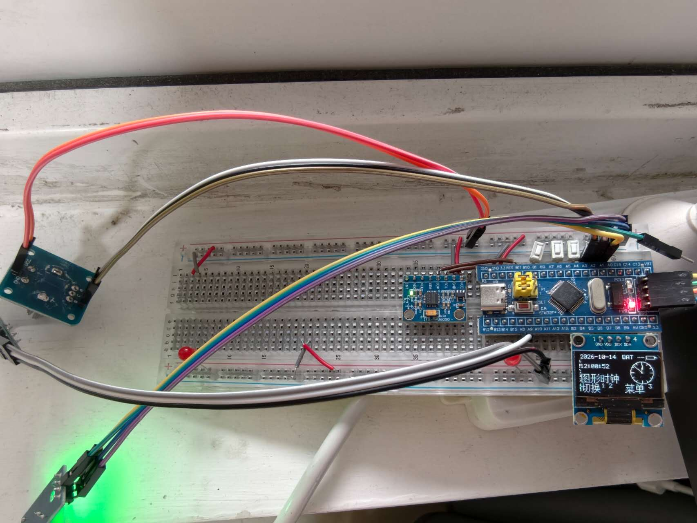
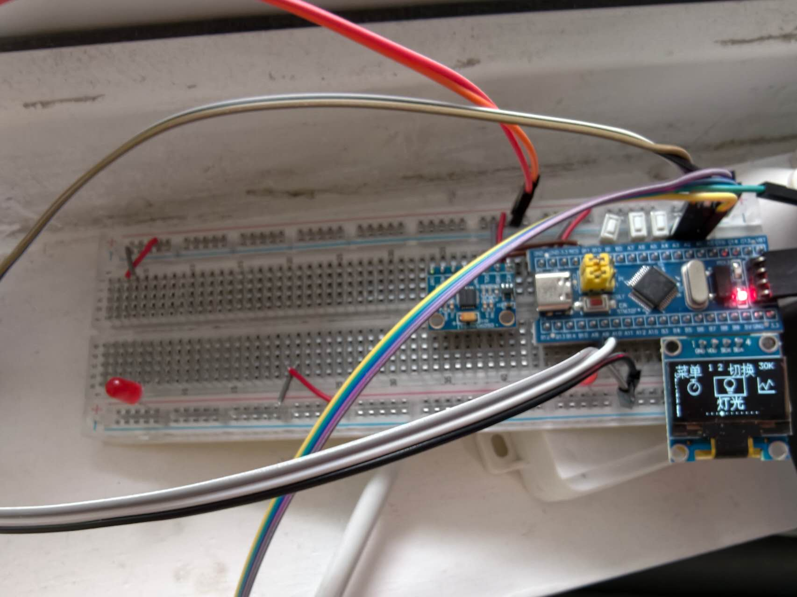
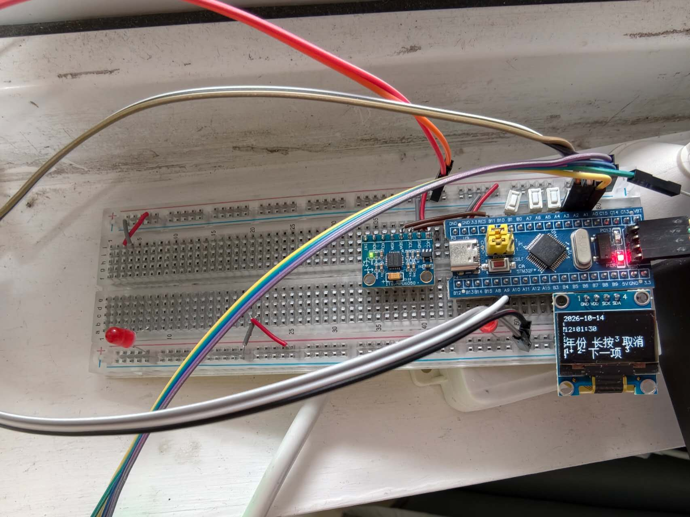
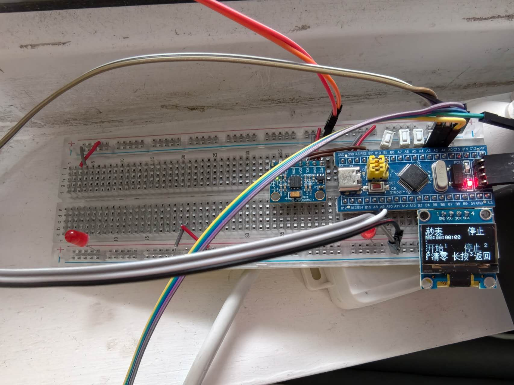
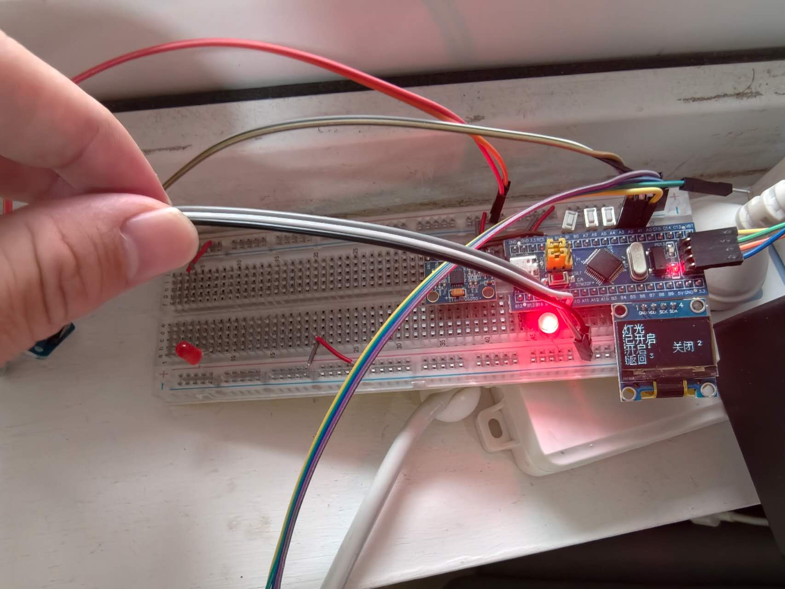
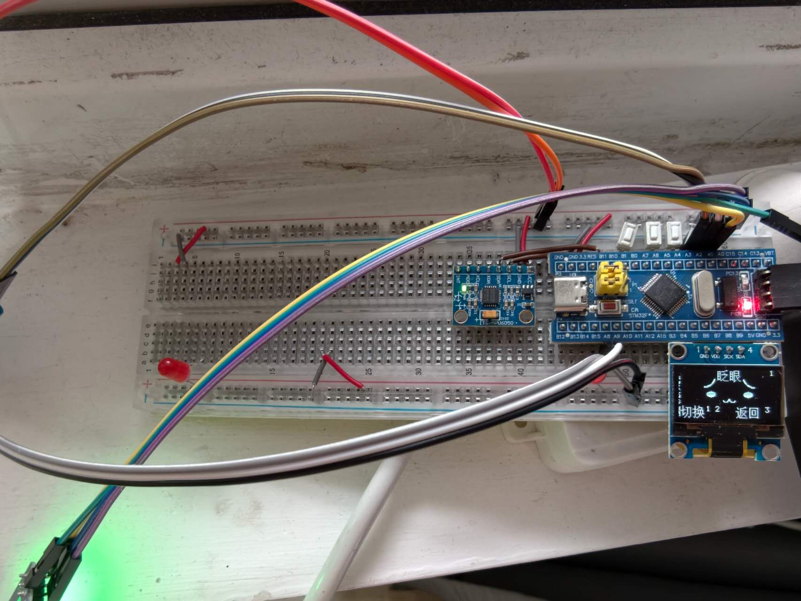
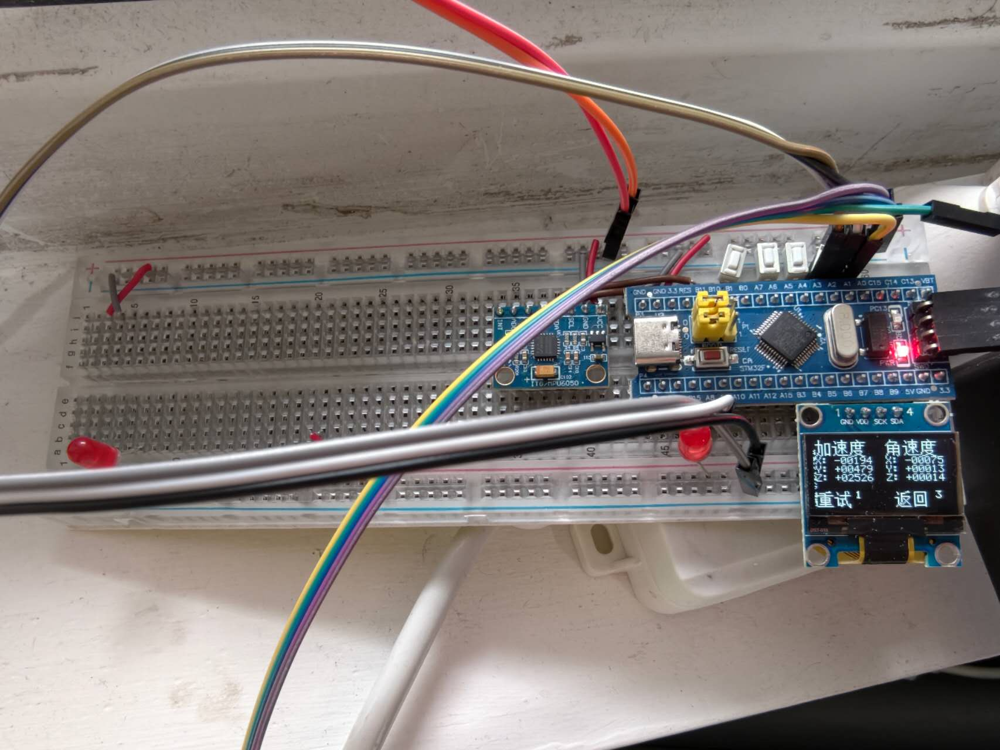
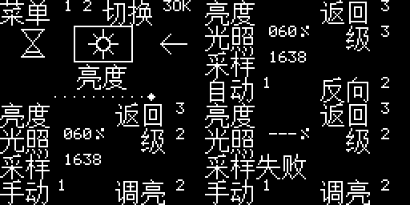

# STM32 多功能交互时钟与环境感知系统

基于 STM32F103C8T6 的模块化嵌入式实践项目。在参考手表工程基础上，移植到 STM32CubeMX / STM32CubeIDE，并扩展倒计时蜂鸣提醒、相对光照检测、自动亮度和旋转编码器菜单输入。

> **发布准备状态**：参考工程及部分点阵素材的再发布授权尚待确认；当前仅作私有备份与整理验证，不代表已经取得完整开源授权。请先阅读 [来源说明](THIRD_PARTY.md) 和 [许可证状态](LICENSE_STATUS.md)，不要直接给全仓库添加统一许可证。

## 功能

| 类别 | 内容 |
| --- | --- |
| 时间管理 | 数字 / 指针时钟、日期显示、时间设置、秒表、倒计时与蜂鸣提醒 |
| 界面交互 | 横向图标与中文菜单、按键长短按、旋钮切换菜单、息屏及按键唤醒 |
| 运动感知 | 六轴原始数据、姿态角、电子水平仪、参考归零 |
| 环境亮度 | 光敏采样、相对光照百分比、四档自动亮度、手动调节 |
| 辅助功能 | 外接灯控制、小恐龙游戏、六种动态表情 |
| 驱动处理 | 按键消抖、采样平滑、阈值回差、显示变化区域刷新与通信失败恢复 |

当前使用最小系统板和外接模块搭建原型，没有独立手表电路板、电池管理或无线通信。息屏只关闭显示输出；主页电量是占位信息。光照百分比未标定为实际照度，偏航角会漂移，不能用作指南针。

## 实物与功能展示

以下8张照片由项目作者提供，展示面包板原型及实际屏幕画面。点击照片可查看原尺寸，便于辨认屏幕细节。照片中的日期为设备当时显示的时间，不作为拍摄日期或校时精度依据。

<table>
  <tr>
    <td width="50%" valign="top">
      <p><strong>数字时钟与原型搭建</strong></p>
      <a href="docs/images/hardware/digital-clock.jpg"></a>
      <p>显示日期、数字时间及底部操作提示，可见面包板上的主控、运动传感器和外接模块。键1/2切换显示，键3进入菜单；BAT --为电量占位信息。</p>
    </td>
    <td width="50%" valign="top">
      <p><strong>指针时钟主页</strong></p>
      <a href="docs/images/hardware/analog-clock.jpg"></a>
      <p>在数字时间旁加入模拟表盘，通过时针、分针和秒针呈现时间；与数字时钟共用实时时间数据，可按键切换显示形式。</p>
    </td>
  </tr>
  <tr>
    <td width="50%" valign="top">
      <p><strong>横向图文菜单</strong></p>
      <a href="docs/images/hardware/horizontal-menu.jpg"></a>
      <p>照片中选中“灯光”，中心图标有选中框，两侧显示相邻功能，底部圆点表示菜单位置。键1/2或旋钮用于移动，键3确认。</p>
    </td>
    <td width="50%" valign="top">
      <p><strong>日期与时间设置</strong></p>
      <a href="docs/images/hardware/time-setting.jpg"></a>
      <p>照片停留在“年份”编辑项。键1增加、键2减少，短按3进入下一项；最后一项确认后保存，长按3取消编辑。</p>
    </td>
  </tr>
  <tr>
    <td width="50%" valign="top">
      <p><strong>秒表页面</strong></p>
      <a href="docs/images/hardware/stopwatch.jpg"></a>
      <p>照片显示秒表处于停止、清零状态。页面提供开始、停止、清零及长按返回提示；此静态画面不用于证明计时精度。</p>
    </td>
    <td width="50%" valign="top">
      <p><strong>外接灯控制</strong></p>
      <a href="docs/images/hardware/led-control.jpg"></a>
      <p>屏幕显示“已开启”，旁侧红色外接LED（发光二极管）点亮。键1开启、键2关闭、键3返回，显示状态与灯光输出联动。</p>
    </td>
  </tr>
  <tr>
    <td width="50%" valign="top">
      <p><strong>表情页面</strong></p>
      <a href="docs/images/hardware/emoji-blink.jpg"></a>
      <p>显示六种表情中的“眨眼”画面及当前编号。键1/2切换表情，键3返回；照片记录动画中的单个画面。</p>
    </td>
    <td width="50%" valign="top">
      <p><strong>六轴运动数据显示</strong></p>
      <a href="docs/images/hardware/motion-data.jpg"></a>
      <p>显示MPU6050的X/Y/Z三轴加速度和三轴角速度原始计数，支持重试与返回。这些数字尚未换算为物理单位，不是姿态角或精度测试结果。</p>
    </td>
  </tr>
</table>

这些照片补充了上述页面与原型的实物展示，但不替代当前提交的全部功能验收；完整演示视频、旋钮操作效果及其他页面实拍仍可后续补充。接线复现请以[硬件接线说明](docs/WIRING.md)为准，不按照片中交叉遮挡的导线推断电源连接。

## 亮度界面模拟预览



此图为界面模拟图，**不是开发板实拍或实测采样结果**；与上方真实照片分开展示。

## 开发环境

- 主控：STM32F103C8T6，64 KB Flash、20 KB RAM。
- STM32CubeIDE 2.1.1；STM32CubeMX 6.17.0。
- STM32Cube FW_F1 V1.8.7；GNU Tools for STM32 14.3.rel1。
- C 语言、HAL（硬件抽象库）、软件 I²C（双线通信）、ADC（模数转换器）、RTC（实时时钟）、外部中断。
- 系统时钟 72 MHz，RTC 使用外部 32.768 kHz 晶振，ADC 时钟 12 MHz。

## 快速开始

1. 按 [硬件接线](docs/WIRING.md) 连接模块，断电接线并确认供电与共地。
2. 启动 STM32CubeIDE，使用 `File → Import → General → Existing Projects into Workspace` 选择本目录。工程内部名称保持为 `Watch_Cube`，仓库文件夹名称可以不同。
3. 选择 `Debug` 配置并执行 `Project → Build Project`。仓库不提供本机 `Debug` 目录，开发环境会重新生成。
4. 根据 [编译与下载说明](docs/BUILD.md) 在自己的电脑上创建调试配置。下载会改写芯片程序，应先确认目标板和已有固件。
5. 参考 [操作说明](docs/USAGE.md) 使用各页面。

## 项目结构

```text
Core/                  应用代码与芯片启动代码
Drivers/               厂家驱动及其原始许可证
docs/                  接线、操作、构建、架构和验证说明
Watch_Cube.ioc         CubeMX 引脚与外设配置
.project / .cproject   CubeIDE 工程配置
makefile.defs          新增模块的构建兼容配置
STM32F103C8TX_FLASH.ld  芯片程序与内存布局
THIRD_PARTY.md         参考工程及第三方内容来源
LICENSE_STATUS.md     当前授权状态
```

## 从哪里读代码

先读 `led.c → key.c → main.c 的 main() → menu.c`，再读计时、光照、编码器、显示和运动模块。项目新增应用代码带有中文说明；系统及厂家代码保留原有内容。

- [软件架构与关键实现](docs/ARCHITECTURE.md)
- [验证记录与限制](docs/VALIDATION.md)
- [发布前检查](docs/PUBLISHING.md)

## 项目来源

参考 [BQT0411/STM32-WATCH](https://github.com/BQT0411/STM32-WATCH)。本项目以移植与扩展为定位，基础功能、既有算法或图案不声明为全部原创。厂家驱动的授权与参考应用工程的授权分别处理，详见 [THIRD_PARTY.md](THIRD_PARTY.md)。
