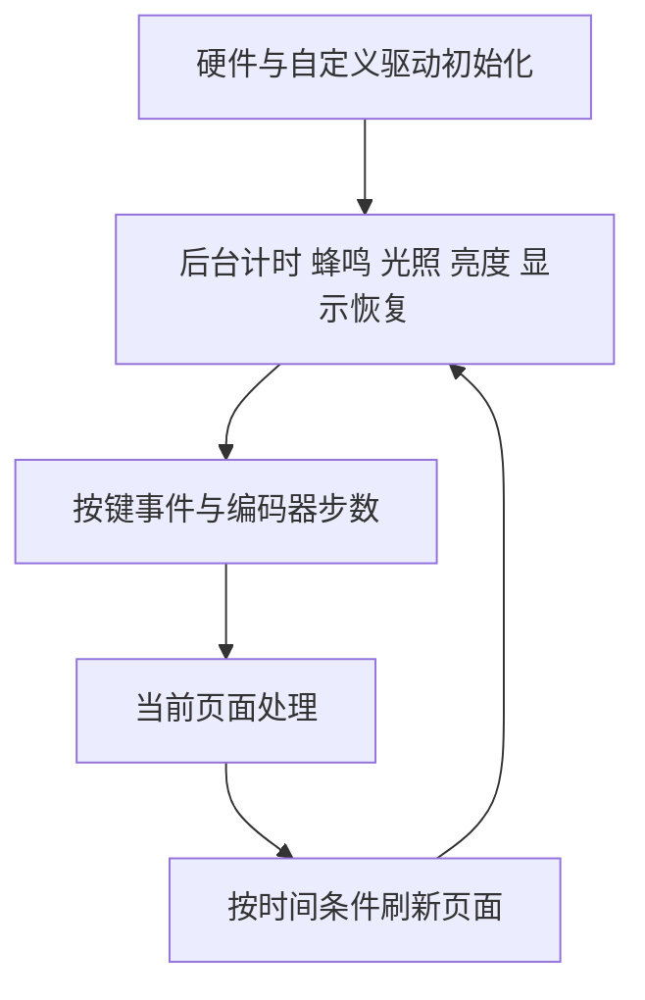

# 软件结构

系统采用C语言、HAL硬件抽象库与主循环调度，没有RTOS（实时操作系统）。应用用 `page` 状态决定当前处理哪些输入、绘制哪个界面。

| 模块 | 责任 |
| --- | --- |
| main | 页面状态、应用调度、计时与亮度策略 |
| menu | 图标、名称、选项移动和确认动作 |
| key / encoder | 按键消抖与事件、A/B正交旋转解码 |
| oled | 软件总线、文字绘图、变化范围传输、恢复 |
| myrtc | 累计秒数与公历日期换算、时间读写 |
| mpu6050 | 六轴采样、静止零偏、姿态计算 |
| light_sensor | ADC校准、周期采样与平滑 |
| buzzer / led | 蜂鸣节奏、灯光电平控制 |
| dino / emoji | 游戏状态与动画 |

## 关键实现

- 计时累计实际毫秒差，显示按需刷新，两者分开；恢复倒计时时重新记录时间起点。
- 编码器双边沿中断仅更新状态与累计步数，主循环原子地取出并清零，再更新菜单。
- 光敏约50毫秒采样，使用约1/8权重新值的指数平滑；四档亮度的升降阈值有回差，减少边界跳档。
- OLED像素按8条高8像素横带保存，每份完整图像1024字节。绘图草稿与最终期望画面分开，失败时保留期望内容，重连后分批补画。
- MPU6050初始量程±16g和±2000度/秒。四元数积分结合重力反馈，偏航没有绝对方位约束，长期会漂移。

新手可先读头文件了解调用，再看同名源文件。主循环的四段注释对应后台任务、输入、页面状态机、按需刷新。
